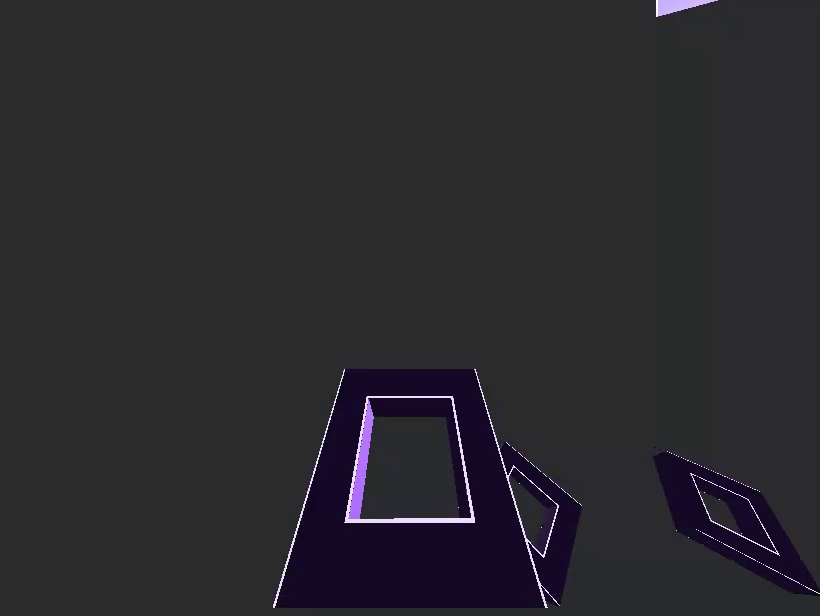

# A2RL FPV Drone Racing

An indoor FPV racing research project using Elodin for flight dynamics and Betaflight SITL for flight control. The student pilot uses monocular RGB and synchronized IMU samples.

[Open the English training dashboard](https://a2rl-fpv-dashboard.front.cbgpu.com/).



The public dashboard shows the replay, its simulator, and evaluation histories. The saved **Flow teacher evaluation** shows a complete 2026 practice race flown in Elodin with Betaflight SITL. Its Mode 2 overlay follows the RC channels sent to Betaflight, with yaw and throttle on the left and roll and pitch on the right. The status panel shows **No live training** when no live run is connected.

## Aircraft, camera, and course

| Component | Implementation |
| --- | --- |
| Reference aircraft | A2RL × DCL carbon-frame quadrotor, 966 g, approximately 30 × 28 × 10 cm, 5-inch-class propellers, XNOVA Black Thunder 2207 2100 KV motors, 6S 1400 mAh battery |
| Vehicle model | Elodin rigid body and rotor dynamics with Betaflight SITL rate control and mixing. Swept gate-frame queries use Parry geometry. |
| Camera | Monocular FPV RGB with IMX219 fisheye calibration. Mount pitch is 51.33° for the 2025 profile and 70° for the 2026 practice profile. The reference camera logs 820 × 616 at 90 Hz. The simulator delivers observations and accepts stick input at 30 Hz. |
| Course | 2026 race reconstruction with 12 scored apertures per lap. The 2025 baseline uses 11 apertures from the published flight plan. |
| Arena | Competition gate textures and an arena reconstructed from photographs, with approximate ceiling and lighting geometry |

HDZero-style breakup approximates localized degradation on a weak digital link. The camera model currently omits rolling shutter, motion blur, and measured exposure response.

- [TU Delft Grand Challenge flight plan](https://github.com/tudelft/optimal_quad_control_RL/blob/a2rl2025/flight_plans/grand_challenge.json)
- [MonoRace flight logs and camera calibration](https://doi.org/10.4121/039abd82-094c-4c93-baa1-e7446f562e0e)
- [MonoRace competition results](https://arxiv.org/html/2601.15222)
- [Competition aircraft specifications](https://onlinelibrary.wiley.com/doi/10.1002/rob.70371)
- [HDZero pixel-level breakup](https://www.hd-zero.com/motion-clarity)

### Aerodynamic calibration

The [simulator validation report](docs/simulator-validation.md) includes the MSP command path, the full-course check, and reproducible comparisons with held-out MonoRace flight logs.

The gate geometry uses swept sphere–box queries. The acceleration scripts compare fitted thrust and drag equations with measured inputs from held-out flights.

```bash
cargo build --release --lib --no-default-features
python -m tools.check_flight_log path/to/imu.csv path/to/ekf.csv
python -m tools.check_lateral_drag --calibration log8/imu.csv log8/ekf.csv \
  --flight Log8-holdout log8/imu.csv log8/ekf.csv 62.4 69.8 \
  --flight Log5 log5/imu.csv log5/ekf.csv 10.85 30 \
  --flight Log7 log7/imu.csv log7/ekf.csv 26.45 44.5
```

| Check | Measured result |
| --- | --- |
| Held-out MonoRace Log 8 axial specific force | RMSE fell from 29.81 to 3.41 m/s² over 367 20 ms windows using measured motor speed and EKF inputs |

Horizontal drag was fitted on 319 early windows from Log 8. On two separate flights withheld from fitting, forward/lateral acceleration RMSE fell from **5.79/4.50 to 1.57/1.99 m/s²** on Log 5 and from **3.26/9.16 to 1.40/2.25 m/s²** on Log 7. These comparisons use recorded IMU and EKF data. Real command-to-motor response, body rates, sustained trajectories, and physical gate contacts require independent validation. The published M16 parameters supply the motor-speed limit and nominal 30 ms response lag.

### Elodin and Betaflight flight validation

The Elodin runner uses the A2RL 2025 reference airframe and supports the 2025 and 2026 practice layouts. Betaflight SITL runs its rate controller and mixer at 1 kHz in lockstep with the plant. The policy reads 30 Hz FPV and synchronized body-frame gyro and acceleration. It emits Mode 2 channels in AETR order. Elodin passes these channels to the firmware's SITL receiver via UDP. The 2026 teacher produces demonstration files for offline imitation, and learned pilots can be evaluated in the same Elodin runner.

Set `A2RL_COURSE=2026-practice` to use the 2026 race reconstruction. The horizontal gate centers and headings come from Figure 5 in FlyBy's competition flight report. Figure 2 shows the two double apertures used for the Split-S and Ladder. The simulated sequence scores 12 apertures per lap. The organizer describes a 14-gate arena. The model uses estimated gate heights, start location, LED dimensions, and hall bounds. [FlyBy flight data and figures](https://www.imavs.org/pdf/imav.2026.1) · [Organizer race page](https://a2rl.io/autonomous-drone-race) · [Organizer fixtures photo](https://a2rl.io/news/45/a2rl-drone-championship-sets-the-pace-for-ai-in-autonomous-fligh)


The [airframe profile](assets/a2rl-2025-airframe.toml) describes the 966 g aircraft, inertia, motor response, and drag fit used in this project. Set `A2RL_AIRFRAME` to a measured replacement profile as data becomes available. The original Rust fisheye renderer produces FPV from Elodin's time-stamped position and attitude. The recorded 480 × 360 video and the policy's 96 × 72 RGB images derive from the same frames. The renderer keeps the floor, curtain walls, ceiling lights, and optional HDZero-style breakup. The Elodin editor can separately show its pinhole preview with `A2RL_ELODIN_PREVIEW=1`. Firmware rates and hardware for the entry year still require their own measurements.

Build the Rust library and set up the external Elodin harness. The harness commit and Elodin release below pin the bridge and camera API. Install Git LFS before cloning to retrieve its visual assets.

```bash
cargo build --release --lib --no-default-features
git clone https://github.com/elodin-sys/ai-grand-prix.git /path/to/elodin-agp
git -C /path/to/elodin-agp checkout 13f9f9e3d5a3130f0ce0b65500d9f309cc1e11b2
git -C /path/to/elodin-agp submodule update --init --depth 1 betaflight
export A2RL_ELODIN_ROOT=/path/to/elodin-agp
(cd "$A2RL_ELODIN_ROOT" && uv sync --locked --python 3.13 && bash scripts/build_betaflight.sh)
source "$A2RL_ELODIN_ROOT/.venv/bin/activate"
uv pip install elodin==0.17.3
uv pip install --index-url https://download.pytorch.org/whl/cpu torch
export ELODIN_ASSETS_DIR="$A2RL_ELODIN_ROOT/assets"
export UV_NO_SYNC=1
```

Install the Elodin 0.17.3 CLI, then record a complete teacher rollout or evaluate an RGB+IMU checkpoint:

```bash
a2rl_root="$PWD"
cd "$A2RL_ELODIN_ROOT"
A2RL_COURSE=2026-practice A2RL_ELODIN_SECONDS=45 A2RL_ELODIN_DB="$(mktemp -d)/flight" \
  A2RL_ELODIN_FLOW_TEACHER=1 \
  A2RL_ELODIN_FPV="$a2rl_root/runs/elodin/teacher.mp4" \
  A2RL_ELODIN_DEMONSTRATION="$a2rl_root/runs/elodin/teacher.npz" \
  elodin run "$a2rl_root/tools/elodin_a2rl.py"
A2RL_COURSE=2026-practice A2RL_ELODIN_POLICY="$a2rl_root/runs/mck-imu-racing-v1/best.pt" \
  A2RL_ELODIN_DB="$(mktemp -d)/flight" elodin editor "$a2rl_root/tools/elodin_a2rl.py"
```

Use a fresh `A2RL_ELODIN_DB` for each rollout. The runner loads the checked-in [Betaflight SITL preset](assets/a2rl-betaflight-sitl.cli) into a fresh firmware working directory. FFmpeg records the shared camera when `A2RL_ELODIN_FPV` is set. Set `A2RL_ELODIN_CHASE=1` to render a synchronized third-person recording from the same Elodin state. The replay has synchronized RC and race-result JSON sidecars. The demonstration and its IMU sidecar are saved only after two clean laps. `A2RL_ELODIN_START_SIDE` sets the lateral start offset in meters. `A2RL_FPV_EXPOSURE`, `A2RL_FPV_BREAKUP`, and `A2RL_FPV_SEED` set the camera effect parameters. Full flight-log agreement for the target airframe remains unverified. [Elodin release](https://github.com/elodin-sys/elodin/releases/tag/v0.17.3) · [Upstream lockstep bridge](https://github.com/elodin-sys/ai-grand-prix/blob/13f9f9e3d5a3130f0ce0b65500d9f309cc1e11b2/ARCHITECTURE.md)

### Experimental three-aircraft heat

The heat runner starts three Elodin plants and Betaflight SITL instances on the same practice course. At each FPV sample it exchanges positions, renders nearby aircraft as simplified silhouettes, and checks swept separation between pairs. A collision ends the involved aircraft's scored flight. Each learned pilot receives its own RGB and IMU stream. The current contact model uses a 38 cm center-to-center threshold.

Apply [the SITL instance-port patch](assets/betaflight-sitl-instance-ports.patch) to a separate checkout of the pinned Betaflight source and build the lockstep SITL target. Point `A2RL_SITL_EXECUTABLE` to that binary and rebuild the Rust renderer before running a heat.

```bash
python -m tools.elodin_heat --harness "$A2RL_ELODIN_ROOT" --out runs/three-aircraft --seconds 35
```

Use `--policy` to evaluate a shared RGB/IMU checkpoint or `--collect-demonstrations` to record clean teacher flights. Set `--launch-interval` to stagger takeoff for following practice. The runner releases demonstration files only after a clean two-lap flight and a maximum timing difference of two FPV frames. Each aircraft advances against a common wall-time pace, and the coordinator checks contact against matching simulation samples. The camera uses the most recent pose available when a peer is behind. The GPU training service continues to use its existing single-aircraft data.

Train from the recorded Elodin teacher and real pilot data:

```bash
python -m training.imitate --device cuda --imu --stack 8 \
  --real runs/mck/train/*.npz --held-out runs/mck/holdout/flight-15p-trackRATM.npz \
  --sim runs/elodin/teacher.npz --out runs/elodin-imitation
```

## Train and evaluate

Run the GPU worker inside the training checkout after producing synchronized demonstrations and a seed checkpoint with `training.imitate --imu --stack 8`.

```bash
bash tools/run_rgb_imu_race.sh runs/target-12 runs/target-12/seed/latest.pt runs/target-12/teacher/nominal.npz
```

Run the evaluator and loopback replay feed on the GPU host. Install the pinned Elodin harness with its Python dependencies, PyTorch, and FFmpeg first.

```bash
python3 -m tools.evaluate_rgb_imu_race \
  --local-run runs/target-12 --harness "$A2RL_ELODIN_ROOT" \
  --in-process --out runs/target-12/firmware \
  --public runs/target-12/public --rollout-corrections runs/target-12/firmware-recovery \
  --completion-rollouts
python3 -m training.live_feed --run runs/target-12 --media runs/target-12/public --port 8766
```

The GPU trains with synchronized teacher demonstrations and correction labels from student rollouts. The student observes only RGB and IMU. Teacher inputs are supervision targets. Assisted rollouts expand training coverage. Published replays and qualification use independent student flights.

1. **Completion imitation.** Clear all 24 apertures on the two-lap course, with three clean starts.
2. **Pace imitation.** Increase the reference demonstration fraction from 60% to 80%. Qualify at or below 30 seconds in three clean starts.
3. **Speed optimization.** The target is 12 seconds after pace qualification. This stage is awaiting an Elodin reinforcement learner.

The application benchmark uses the reference airframe profile, 70° camera mount, clean RGB, and a nominal launch for the replay and lap time. Two 3 cm launch offsets check repeatability within the same setup. For separate transfer experiments, run the checkpoint with `A2RL_AIRFRAME` pointing to a measured variant and `A2RL_FPV_MOUNT_PITCH` set to the desired camera pitch in degrees. Keep evaluation outputs in a fresh directory and record completion and timing for each configuration. Simulated variation measures sensitivity within the model. Physical transfer still needs flight data from the intended aircraft.

The dashboard's Student view opens the latest Elodin + Betaflight student recording with its matching stick inputs. The status panel reports the worker’s training progress. The loopback feed serves only the status and published replay assets. An HTTPS tunnel connects the public dashboard to this feed on GPU 4.

## Watch or download replays

The CBGPU frontend connects automatically. GPU 4 publishes evaluation data and student checkpoint replays even when the original viewing computer is off. A completed replay loops until the next clip is ready, then switches at the end of the current playback. **FPV** and **Third person** switch views of the same recording. **Download this video** saves the displayed view as an MP4. An HTTPS tunnel from GPU 4 currently backs up the managed CBGPU feed. A tunnel restart can change the backup URL. If both feeds are unreachable, the frontend shows a labeled snapshot and MP4 stored with the deployment.

The CBGPU frontend deploys the `main` branch of this repository as a static site with `web` as its root directory and `.` as the output directory. It needs no install or build command. The simulator, training code, and feed server live in the same repository.

## CBGPU GPU 4

During an authorized reservation, use the configured SSH alias. Campus-network users can use `cbgpu-gpu4-school`. This workspace stores Git metadata in `.a2rl-git/`.

```bash
ssh cbgpu-gpu4 nvidia-smi
git --git-dir=.a2rl-git --work-tree=. archive HEAD |
  ssh cbgpu-gpu4 'mkdir -p ~/a2rl-racing && tar -x -C ~/a2rl-racing'
ssh cbgpu-gpu4
cd ~/a2rl-racing
```

## Checks

```bash
cargo test
cargo build --release --lib --no-default-features
python -m unittest discover -s tests -v
```
