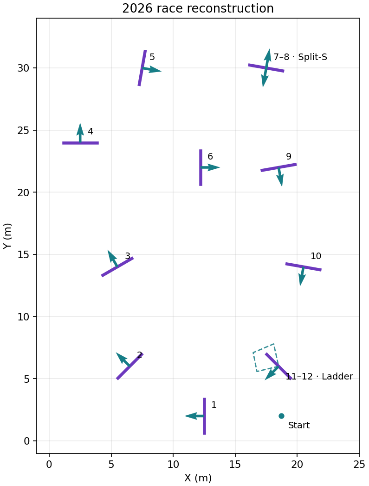

# A2RL FPV Drone Racing

An indoor FPV racing research project with a Rust simulator for batch experiments and Elodin with Betaflight SITL for firmware validation. Pilots can use monocular RGB frames and synchronized IMU samples.

[Open the English training dashboard](https://a2rl-fpv-dashboard.front.cbgpu.com/).


The public dashboard shows the replay, its simulator, and evaluation histories. The saved **Flow teacher evaluation** shows one complete Rust simulation race and the results of the teacher's validation batch. Its Mode 2 overlay follows the replay timestamp, with yaw and throttle on the left and roll and pitch on the right. The overlay is a dashboard control display sourced from the recorded stick commands. The status panel shows **No live training** when no live run is connected.

## Fly the course

Run from the project root with Rust 1.88 or later. The desktop app uses eframe on Wayland or X11 on Linux.

```bash
A2RL_COURSE=2026-practice cargo run --release
```

Select **Start flight** or press **Space**. Set throttle with **W** and **S** during the three-second countdown. Physics starts on **GO**, and the HUD shows lap and elapsed time.

| Control | Key |
| --- | --- |
| Increase or decrease throttle | W / S |
| Yaw left or right | A / D |
| Pitch forward or back | ↑ / ↓ |
| Roll left or right | ← / → |
| Start, pause, or resume | Space |
| Reset | R |
| Toggle fullscreen | F11 |
| Toggle HDZero-style breakup | N |

Releasing yaw, pitch, or roll centers the corresponding rate command. The aircraft retains its attitude. Throttle stays at the last setting until changed or reset. An official race counts 22 gate passages. Timing begins at the first Gate 1 crossing and ends at the second Gate 11 crossing.

## Aircraft, camera, and course

| Component | Implementation |
| --- | --- |
| Reference aircraft | A2RL × DCL carbon-frame quadrotor, 966 g, approximately 30 × 28 × 10 cm, 5-inch-class propellers, XNOVA Black Thunder 2207 2100 KV motors, 6S 1400 mAh battery |
| Vehicle model | Six-degree-of-freedom rigid body at 240 Hz, four first-order motor responses, thrust and torque, body-rate control, aerodynamic drag, swept gate collision checks |
| Camera | Monocular FPV RGB with IMX219 fisheye calibration. Mount pitch is 51.33° for the 2025 profile and 45° for the 2026 practice profile. The reference camera logs 820 × 616 at 90 Hz. The simulator delivers observations and accepts stick input at 30 Hz. |
| Course | Eleven 1.5 m openings from the published 2025 Grand Challenge plan, including two double frames and the Gate 5–6 Split-S |
| Arena | Competition gate textures and an arena reconstructed from photographs, with approximate ceiling and lighting geometry |

HDZero-style breakup approximates localized degradation on a weak digital link. The camera model currently omits rolling shutter, motion blur, and measured exposure response.

- [TU Delft Grand Challenge flight plan](https://github.com/tudelft/optimal_quad_control_RL/blob/a2rl2025/flight_plans/grand_challenge.json)
- [MonoRace flight logs and camera calibration](https://doi.org/10.4121/039abd82-094c-4c93-baa1-e7446f562e0e)
- [MonoRace competition results](https://arxiv.org/html/2601.15222)
- [Competition aircraft specifications](https://onlinelibrary.wiley.com/doi/10.1002/rob.70371)
- [HDZero pixel-level breakup](https://www.hd-zero.com/motion-clarity)

### Native physics validation

The [simulator validation report](docs/simulator-validation.md) includes the MSP command path, the full-course check, and reproducible comparisons with held-out MonoRace flight logs.

The Rust simulator integrates the rigid body with glam and uses Parry for swept sphere–box gate contacts. A regression test distinguishes a corner collision from a near miss.

```bash
cargo build --release --lib --no-default-features
python -m tools.check_flight_log path/to/imu.csv path/to/ekf.csv
python -m tools.check_lateral_drag --calibration log8/imu.csv log8/ekf.csv \
  --flight Log8-holdout log8/imu.csv log8/ekf.csv 62.4 69.8 \
  --flight Log5 log5/imu.csv log5/ekf.csv 10.85 30 \
  --flight Log7 log7/imu.csv log7/ekf.csv 26.45 44.5
```

| Check | Measured result |
| --- | --- |
| Held-out MonoRace Log 8 axial specific force | RMSE fell from 29.81 to 3.41 m/s² over 367 20 ms windows using measured motor speed and EKF inputs |

Horizontal drag was fitted on 319 early windows from Log 8. On two separate flights withheld from fitting, forward/lateral acceleration RMSE fell from **5.79/4.50 to 1.57/1.99 m/s²** on Log 5 and from **3.26/9.16 to 1.40/2.25 m/s²** on Log 7. These comparisons use recorded IMU and EKF data. Real command-to-motor response, body rates, sustained trajectories, and physical gate contacts require independent validation. The published M16 parameters supply the motor-speed limit and nominal 30 ms response lag.

Use a new run directory when changing courses or the vehicle model. Existing policy weights can initialize a new run. Resumable state includes the physics identity because replay buffers contain transitions from that environment. [Parry queries](https://parry.rs/docs/user_guide/geometric_queries/)

### Elodin and Betaflight flight validation

The Elodin runner uses the A2RL 2025 reference airframe and supports the 2025 and 2026 practice layouts. Betaflight SITL runs its rate controller and mixer at 1 kHz in lockstep with the plant. The policy reads 30 Hz FPV and synchronized body-frame gyro and acceleration. It emits Mode 2 channels in AETR order. Elodin passes these channels to the firmware's SITL receiver via UDP. Batch training currently uses the Rust learner. An Elodin rollout is a separate validation run.

Set `A2RL_COURSE=2026-practice` to use the 2026 race reconstruction. The horizontal gate centers and headings come from Figure 5 in FlyBy's competition flight report. Figure 2 shows the two double apertures used for the Split-S and Ladder. The simulated sequence scores 12 apertures per lap. The organizer describes a 14-gate arena. The model uses estimated gate heights, start location, LED dimensions, and hall bounds. [FlyBy flight data and figures](https://www.imavs.org/pdf/imav.2026.1) · [Organizer race page](https://a2rl.io/autonomous-drone-race) · [Organizer fixtures photo](https://a2rl.io/news/45/a2rl-drone-championship-sets-the-pace-for-ai-in-autonomous-fligh)



The [airframe profile](assets/a2rl-2025-airframe.toml) describes the 966 g aircraft, inertia, motor response, and drag fit used in this project. Set `A2RL_AIRFRAME` to a measured replacement profile as data becomes available. The original Rust fisheye renderer produces FPV from Elodin's time-stamped position and attitude. The recorded 480 × 360 video and the policy's 96 × 72 RGB images derive from the same frames. The renderer keeps the floor, curtain walls, ceiling lights, and optional HDZero-style breakup. The Elodin editor can separately show its pinhole preview with `A2RL_ELODIN_PREVIEW=1`. Firmware rates and hardware for the entry year still require their own measurements.

Build the Rust library and set up the external Elodin harness. The harness commit and Elodin release below pin the bridge and camera API. Install Git LFS before cloning to retrieve its visual assets.

```bash
cargo build --release --lib --no-default-features
git clone https://github.com/elodin-sys/ai-grand-prix.git /path/to/elodin-agp
git -C /path/to/elodin-agp checkout 13f9f9e3d5a3130f0ce0b65500d9f309cc1e11b2
git -C /path/to/elodin-agp submodule update --init --depth 1 betaflight
export A2RL_ELODIN_ROOT=/path/to/elodin-agp
(cd "$A2RL_ELODIN_ROOT" && uv sync --locked --python 3.13 && bash scripts/build_betaflight.sh)
source "$A2RL_ELODIN_ROOT/.venv/bin/activate"
uv pip install elodin==0.17.3
uv pip install --index-url https://download.pytorch.org/whl/cpu torch
export ELODIN_ASSETS_DIR="$A2RL_ELODIN_ROOT/assets"
export UV_NO_SYNC=1
```

Install the Elodin 0.17.3 CLI, then run a short takeoff check or evaluate an RGB+IMU checkpoint:

```bash
a2rl_root="$PWD"
cd "$A2RL_ELODIN_ROOT"
A2RL_COURSE=2026-practice A2RL_ELODIN_SECONDS=1.4 A2RL_ELODIN_DB="$(mktemp -d)/flight" \
  A2RL_ELODIN_FPV="$a2rl_root/runs/validation/elodin-takeoff.mp4" \
  elodin run "$a2rl_root/tools/elodin_a2rl.py"
A2RL_COURSE=2026-practice A2RL_ELODIN_POLICY="$a2rl_root/runs/mck-imu-racing-v1/best.pt" \
  A2RL_ELODIN_DB="$(mktemp -d)/flight" elodin editor "$a2rl_root/tools/elodin_a2rl.py"
```

Use a fresh `A2RL_ELODIN_DB` for each rollout. FFmpeg records the shared camera when `A2RL_ELODIN_FPV` is set. `A2RL_FPV_EXPOSURE`, `A2RL_FPV_BREAKUP`, and `A2RL_FPV_SEED` set the camera effect parameters. The runner reports contacts and ordered passes. A sustained two-lap flight in Elodin and full flight-log agreement for the target airframe remain unverified. [Elodin release](https://github.com/elodin-sys/elodin/releases/tag/v0.17.3) · [Upstream lockstep bridge](https://github.com/elodin-sys/ai-grand-prix/blob/13f9f9e3d5a3130f0ce0b65500d9f309cc1e11b2/ARCHITECTURE.md)

## Policy and rewards

A custom three-layer PyTorch CNN maps RGB frames to a 128-dimensional feature vector. A small MLP outputs four Mode 2 Acro axes. Racing-school runs can use eight 96 × 72 RGB frames and an IMU history with `--imu`. The optional `--backbone mobilenet-v3-small` initializes a truncated encoder with ImageNet weights using torchvision. The pretrained encoder passed a training smoke test. Its full-course performance still needs comparison against the CNN. Simulator state supplies teacher labels and reward calculations. [Torchvision MobileNetV3 Small](https://docs.pytorch.org/vision/stable/models/generated/torchvision.models.mobilenet_v3_small.html)

- Gate progress is positive toward the next gate and negative for retreat. Each segment's progress contribution is bounded.
- Passing a gate earns +2. Completing a lap earns +20, with up to +8 relative to a 24-second baseline. A session-best improvement earns up to +3.
- A valid crossing can earn up to +0.60 for forward crossing speed. On an aligned approach, spending time within 4 m of a gate while closing at under 1.5 m/s also costs reward. Both terms are reduced for sharp transitions, and the Split-S allows braking. Speed evaluation logs approach delay and mean crossing speed.
- Time costs 0.20 per second. A collision costs 18. Fourteen seconds without gate progress incurs a cost of 10 and ends the episode. Practice races can continue for up to 180 seconds.
- Camera observations, lap time, collision rate, and completion are evaluated through the same simulator interface. Evaluation logs retain individual round results and the dashboard also shows an eight-evaluation moving average.

The optional `A2RL_REWARD_PROFILE=pace` compares each completed gate segment against a pace reference based on its distance and change in heading. It adds a two-lap completion bonus, raises the time, collision, and stall penalties, and removes the reward for beating a driver's earlier lap within the same episode. Start from policy weights in a new run when switching reward profiles. Replay snapshots retain their original reward version.

## Train and evaluate

On the 2026 reconstruction, `A2RL_TEACHER_PROFILE=flow` follows a closed racing line through the gate centers, with a curvature-dependent speed profile. The expert follows that line from takeoff through both laps. The student observes FPV and IMU when using `--imu` and receives four Mode 2 Acro labels. Use `--full-course` to retain complete student and expert episodes.

For the 2026 flow teacher, full-course imitation qualifies after repeated clean finishes on fixed and independent starts. The worst run must finish within 20% of the teacher batch's slowest time, spend at most one extra second below 2 m/s after the first gate, and reach at least 80% of the teacher's mean gate crossing speed. The MCK transmitter logs are from TII's trackRATM and can supplement the course-specific simulation labels. [Flight validation report](docs/simulator-validation.md) · [TII MCK data](https://github.com/tii-racing/drone-racing-dataset/releases/tag/v3.0.0)

Install a CUDA-compatible PyTorch build for the GPU environment. The training stack uses PyTorch and NumPy. FFmpeg encodes dashboard replays.

```bash
python3 -m venv .venv
source .venv/bin/activate
python -m pip install -r training/requirements.txt
cargo build --release --lib --no-default-features
python -m training.train --device cuda --steps 1000000 --envs 8 --eval-episodes 5
python -m training.train --device cuda --evaluate runs/drq/best.pt --eval-episodes 5
```

Use `--device cpu` for local checks. Match frame size and stack depth when evaluating an existing policy. The trainer stores replay frames as uint8, applies the same random image shift across each frame stack, and uses double Q and multi-step returns in a DrQ-v2-style actor–critic. Training mixes launch starts and intermediate practice starts, including the Split-S, slalom, and hairpin. Control video corruption with `--hdzero-max`.

### Imitation and speed optimization

The teacher follows a continuous race line and labels Mode 2 actions from its own runs and from states visited by the student. The 2025 line takes cues from MAVLab Log 5. The 2026 teacher schedules braking ahead of gate openings and allows pitch-up on climbs to higher gates. The student observes RGB and, with `--imu`, synchronized gyro and accelerometer history. Each round uses the same three evaluation starts for comparison. A separate randomized panel checks candidate policies. The full-race progression runs without a round limit, trains for at least six more rounds after the first round that completes both panels, then requires two consecutive rounds of clean qualification without teacher control. Gate progression and optimizer state are saved in `imitation-state.zip`.

`A2RL_TEACHER_PROFILE=flow` preserves forward speed through aligned gates while using the tighter approach controller around turns. Training can also use synchronized human FPV footage and transmitter channels from TII Racing's Race Against the Machine v3 release. The human runs took place on trackRATM, so the A2RL simulator demonstrations still provide course-specific corrections. MCK's logged controls provide real-pilot labels, and a separate real flight can be held out to report stick error. [TII Racing v3 release](https://github.com/tii-racing/drone-racing-dataset/releases/tag/v3.0.0) · [Dataset and CC BY 4.0 license](https://github.com/tii-racing/drone-racing-dataset)

```bash
python -m tools.prepare_mck_demos --list
python -m tools.prepare_mck_demos --flight flight-13p-trackRATM --flight flight-14p-trackRATM --out runs/mck/train
python -m tools.prepare_mck_demos --flight flight-15p-trackRATM --out runs/mck/holdout
```

To train a fresh end-to-end policy on MCK alone, use the two synchronized flights for training and reserve the third for evaluation of stick prediction. The policy trains the RGB encoder, IMU encoder, and Mode 2 actor jointly from scratch. Gyroscope and accelerometer samples use rad/s and m/s² and are aligned at the RGB timestamps. For older RGB exports, rerun the preparation commands with `--imu-only` to add the IMU sidecars. The simulator evaluates transfer to A2RL without providing training samples.

```bash
python -m training.imitate --device cuda --stack 8 --imu \
  --real runs/mck/train/*.npz --held-out runs/mck/holdout/flight-15p-trackRATM.npz \
  --official-eval --out runs/mck-e2e-v1
```

To adapt that RGB+IMU policy to A2RL with simulator demonstrations and supervised corrections:

```bash
A2RL_TEACHER_PROFILE=flow python -m training.racing_school \
  --device cuda --imu --initialize runs/mck-e2e-v1/best.pt --teacher-warmup-rounds 5 \
  --human-demos runs/mck/train/*.npz --human-held-out runs/mck/holdout/flight-15p-trackRATM.npz \
  --out runs/mck-imu-racing-v1
```

Evaluation and replay send the fused policy's four commands through the Betaflight-style MSP v1 RC boundary. The adapter encodes roll, pitch, throttle, and yaw in AETR order with `MSP_SET_RAW_RC`. The simulator decodes the frame, then uses the native Acro controller and mixer for batch simulation. This tests the command interface. Firmware timing, PID behavior, and hardware remain separate validation work. [Betaflight MSP documentation](https://betaflight.com/docs/wiki/guides/current/MSP-Companion-Computer-Control)

Pass these using `A2RL_HUMAN_DEMO_DIR` and `A2RL_HUMAN_HOLDOUT`. During speed RL, `A2RL_SPRINT_EXPLORATION_STEPS` enables full-throttle bursts of up to three control ticks on aligned straights with room before the next gate. The frequency fades to zero by the selected step. The evaluated RGB policy chooses all four sticks on its own.

The [MAVLab race video](https://www.youtube.com/watch?v=yz2in2eFATE) shows the TU Delft autonomous competitor. Its [published MonoRace data](https://doi.org/10.4121/039abd82-094c-4c93-baa1-e7446f562e0e) supplies original onboard frames, motor speeds, and body-rate measurements. In racing school, use `A2RL_MONORACE_DEMO=runs/monorace/log5.npz` and `A2RL_MONORACE_HOLDOUT=runs/monorace/log7.npz` after generating the files below. Estimated Mode 2 labels from the autonomous run enter the loss at weight 0.10, compared with 0.35 for synchronized human transmitter inputs. Each source reports its own held-out error.

```bash
bash tools/run_race_training.sh
```

Use `A2RL_SCHOOL_DIR`, `A2RL_SPEED_DIR`, or `A2RL_INITIAL_POLICY` to select the run folders and initial policy. The launch script starts the speed phase only when `qualified.pt` exists. Speed RL permits unrestricted Mode 2 actions and ranks policies by completion rate, crash rate, and official time. The protected speed run freezes the qualified vision encoder, uses two reference flights to retain successful trajectories, and keeps early actor updates close to the qualified actions. If the next evaluation loses completions or raises the crash rate at the same completion rate, it restores the best validated actor and keeps the critic and experience. Record-target mode uses the 5,000,000-step setting to schedule exploration. It continues until the policy beats 16.56 s from the standard start and all three trials finish cleanly. That target refers to MAVLab's full-scale 2025 run. The resulting simulator benchmark and weights are stored as `record.json` and `record.pt`.

### Reproduce the demonstration and gate-transition experiments

MAVLab Log 5 supplies real-flight samples and Log 7 is reserved for a flight-level holdout. The logs contain direct motor control, so real Mode 2 labels are approximated from synchronized RPM and gyro data. Simulator demonstrations contain the exact applied sticks. These earlier experiments use the default four-frame stack.

```bash
python -m pip install Pillow
python -m tools.prepare_monorace_demos runs/monorace
cargo run --release --no-default-features --example grand_challenge -- --dataset runs/monorace/sim-clean 0
cargo run --release --no-default-features --example grand_challenge -- --dataset runs/monorace/sim-noise 7
python -m training.imitate --real runs/monorace/log5.npz --held-out runs/monorace/log7.npz \
  --sim runs/monorace/sim-clean runs/monorace/sim-noise --out runs/bc
python -m training.train --device cuda --initialize runs/bc/best.pt \
  --demo-sim runs/monorace/sim-clean runs/monorace/sim-noise --run-dir runs/bc-rl
python -m training.train --device cuda --initialize runs/bc-rl/best.pt \
  --focus-gate-two --steps 5000000 --eval-every 25000 --eval-episodes 5 \
  --checkpoint-every 100000 --run-dir runs/gate-two-5m
```

To restart a run from a training snapshot, preserve the environment and replay settings and replace `--initialize` with `--resume path/to/training-state.zip`. New simulator episodes begin at restart.

[DrQ-v2](https://arxiv.org/abs/2107.09645) is the current reference algorithm. [DreamerV3](https://www.nature.com/articles/s41586-025-08744-2), [Ego-Foresight](https://openreview.net/pdf/955430a2085b49a89db12b6bf0d46d60a701caa0.pdf), and [DR.Q](https://proceedings.mlr.press/v306/lyu26f.html) are comparison candidates.

## Watch or download replays

The CBGPU frontend connects automatically. GPU 4 publishes evaluation data and student checkpoint replays even when the original viewing computer is off. A completed replay loops until the next clip is ready, then switches at the end of the current playback. **Download this video** saves the displayed version as an MP4. An HTTPS tunnel from GPU 4 currently backs up the managed CBGPU feed. A tunnel restart can change the backup URL. If both feeds are unreachable, the frontend shows a labeled snapshot and MP4 stored with the deployment.

The CBGPU frontend deploys the `main` branch of this repository as a static site with `web` as its root directory and `.` as the output directory. It needs no install or build command. The simulator, training code, and feed server live in the same repository.

A local browser viewer and a native live view are also available. The browser simulates the latest checkpoint on a standard start and encodes 480 × 360 video. The desktop viewer displays sampled live training frames and labels whether the teacher or student was driving. If live frames stop, it labels checkpoint replays separately.

```bash
python3 -m training.web_watch cbgpu-gpu4
cargo run --release -- --watch cbgpu-gpu4
```

Open [the local browser viewer](http://127.0.0.1:8765/). Closing a viewer does not stop the GPU job.

### Record the scripted race

The following commands generate a two-lap demonstration using simulator-state waypoints. The optional CUDA renderer consumes camera poses exported by Rust. The final argument is the HDZero-style breakup strength.

```bash
cargo run --release --no-default-features --example grand_challenge -- runs/grand-challenge-cpu.mp4
cargo run --release --no-default-features --example grand_challenge -- --poses runs/grand-challenge.poses
nvcc -O3 -arch=sm_75 tools/render_fpv.cu -o render_fpv
./render_fpv runs/grand-challenge.poses assets/grand-challenge-gate.rgb 0.32 |
  ffmpeg -f rawvideo -pixel_format rgb24 -video_size 820x616 -framerate 30 \
    -i - -an -c:v libx264 -pix_fmt yuv420p runs/grand-challenge-gpu.mp4
```

## CBGPU GPU 4

During an authorized reservation, use the configured SSH alias. Campus-network users can use `cbgpu-gpu4-school`. This workspace stores Git metadata in `.a2rl-git/`.

```bash
ssh cbgpu-gpu4 nvidia-smi
git --git-dir=.a2rl-git --work-tree=. archive HEAD |
  ssh cbgpu-gpu4 'mkdir -p ~/a2rl-racing && tar -x -C ~/a2rl-racing'
ssh cbgpu-gpu4
cd ~/a2rl-racing
```

## Checks

```bash
cargo test
cargo build --release --lib --no-default-features
python -m unittest discover -s tests -v
python -m training.train --device cpu --steps 160 --envs 2 --warmup 16 --replay 256 \
  --batch 8 --eval-every 80 --run-dir /tmp/a2rl-smoke
```
