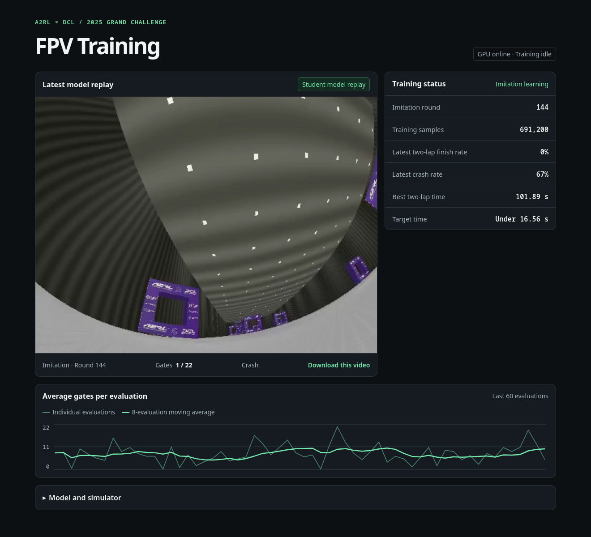
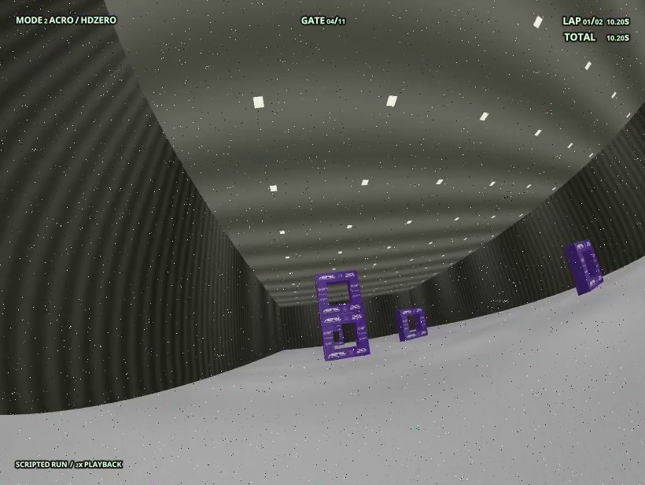

# A2RL FPV Drone Racing

An indoor FPV racing simulator for the 2025 A2RL × DCL Grand Challenge. Fly the course in the Rust desktop app or train a policy using only RGB camera frames. The desktop and training environments share the same camera, course, gate scoring, and vehicle model.

[Open the English training dashboard](https://a2rl-fpv-dashboard.front.cbgpu.com/).





The course image comes from a scripted simulation run. The dashboard capture uses GPU 4's round 144 evaluation and a frame from the corresponding student replay.

## Fly the course

Run from the project root with Rust 1.88 or later. The desktop app uses eframe on Wayland or X11 on Linux.

```bash
cargo run --release
```

Select **Start flight** or press **Space**. Set throttle with **W** and **S** during the three-second countdown. Physics starts on **GO**, and the HUD shows lap and elapsed time.

| Control | Key |
| --- | --- |
| Increase or decrease throttle | W / S |
| Yaw left or right | A / D |
| Pitch forward or back | ↑ / ↓ |
| Roll left or right | ← / → |
| Start, pause, or resume | Space |
| Reset | R |
| Toggle fullscreen | F11 |
| Toggle HDZero-style breakup | N |

Releasing yaw, pitch, or roll centers the corresponding rate command. The aircraft retains its attitude. Throttle stays at the last setting until changed or reset. An official race counts 22 gate passages. Timing begins at the first Gate 1 crossing and ends at the second Gate 11 crossing.

## Aircraft, camera, and course

| Component | Implementation |
| --- | --- |
| Reference aircraft | A2RL × DCL carbon-frame quadrotor, 966 g, approximately 30 × 28 × 10 cm, 5-inch-class propellers, XNOVA Black Thunder 2207 2100 KV motors, 6S 1400 mAh battery |
| Vehicle model | Six-degree-of-freedom rigid body at 240 Hz, four first-order motor responses, thrust and torque, body-rate control, aerodynamic drag, swept gate collision checks |
| Camera | Monocular FPV RGB with IMX219 fisheye calibration and a 51.33° mount pitch. The reference camera logs 820 × 616 at 90 Hz. The simulator delivers observations and accepts stick input at 30 Hz. |
| Course | Eleven 1.5 m openings from the published 2025 Grand Challenge plan, including two double frames and the Gate 5–6 Split-S |
| Arena | Competition gate textures and an arena reconstructed from photographs, with approximate ceiling and lighting geometry |

HDZero-style breakup approximates localized degradation on a weak digital link. The camera model currently omits rolling shutter, motion blur, and measured exposure response.

- [TU Delft Grand Challenge flight plan](https://github.com/tudelft/optimal_quad_control_RL/blob/a2rl2025/flight_plans/grand_challenge.json)
- [MonoRace flight logs and camera calibration](https://doi.org/10.4121/039abd82-094c-4c93-baa1-e7446f562e0e)
- [MonoRace competition results](https://arxiv.org/html/2601.15222)
- [Competition aircraft specifications](https://onlinelibrary.wiley.com/doi/10.1002/rob.70371)
- [HDZero pixel-level breakup](https://www.hd-zero.com/motion-clarity)

### Physics validation and MuJoCo

The default backend integrates the rigid body in Rust with glam. Python rollouts can also use MuJoCo while keeping the same motor model, body-rate controller, camera, scoring, and rewards. Parry performs swept sphere–box collision tests at gate frames for both backends. A regression test distinguishes a real corner contact from a near miss that previously touched the expanded bounding box.

```bash
cargo build --release --lib --no-default-features
python -m pip install mujoco
python -m tools.compare_physics --course
python -m tools.check_flight_log path/to/imu.csv path/to/ekf.csv
python -m tools.check_lateral_drag --calibration log8/imu.csv log8/ekf.csv \
  --flight Log8-holdout log8/imu.csv log8/ekf.csv 62.4 69.8 \
  --flight Log5 log5/imu.csv log5/ekf.csv 10.85 30 \
  --flight Log7 log7/imu.csv log7/ekf.csv 26.45 44.5
```

| Check | Measured result |
| --- | --- |
| Six shared-input tests through two seconds | Rust–MuJoCo position and attitude differences were below 2 µm and 0.00005° |
| Closed-loop teacher on both backends | Both passed all 22 gates in 111.496 s |
| Held-out MonoRace Log 8 axial specific force | RMSE fell from 29.81 to 3.41 m/s² over 367 20 ms windows using measured motor speed and EKF inputs |

Horizontal drag was fitted on 319 early windows from Log 8. On two separate flights withheld from fitting, forward/lateral acceleration RMSE fell from **5.79/4.50 to 1.57/1.99 m/s²** on Log 5 and from **3.26/9.16 to 1.40/2.25 m/s²** on Log 7. These comparisons use measured IMU and EKF data. The simulator agreement tests share the same actuator model. Real command-to-motor response, body rates, sustained trajectories, and physical gate contacts still need independent validation. The published M16 parameters supply the motor-speed limit and nominal 30 ms response lag.

Set `A2RL_PHYSICS_ENGINE=mujoco` for a MuJoCo rollout. Use a new run directory when changing backends or vehicle models. Existing policy weights can initialize a new run. Resumable state includes the physics identity because replay buffers contain transitions from that environment. [MuJoCo documentation](https://mujoco.readthedocs.io/en/stable/) · [Parry queries](https://parry.rs/docs/user_guide/geometric_queries/)

## Policy and rewards

A custom three-layer PyTorch CNN maps a stack of RGB frames to a 128-dimensional feature vector. A small MLP outputs left X, left Y, right X, and right Y in Mode 2 Acro order. The standard trainer defaults to four 96 × 72 RGB frames. The racing-school pipeline uses eight. The input contains camera frames only. Simulator state supplies teacher labels and reward calculations.

- Gate progress is positive toward the next gate and negative for retreat. Each segment's progress contribution is bounded.
- Passing a gate earns +2. Completing a lap earns +20, with up to +8 relative to a 24-second baseline. A session-best improvement earns up to +3.
- Time costs 0.20 per second. A collision costs 18. Fourteen seconds without gate progress incurs a cost of 10 and ends the episode. Practice races can continue for up to 180 seconds.
- Camera observations, lap time, collision rate, and completion are evaluated through the same simulator interface. Evaluation logs retain individual round results and the dashboard also shows an eight-evaluation moving average.

## Train and evaluate

Install a CUDA-compatible PyTorch build for the GPU environment. The training stack uses PyTorch and NumPy. FFmpeg encodes dashboard replays.

```bash
python3 -m venv .venv
source .venv/bin/activate
python -m pip install -r training/requirements.txt
cargo build --release --lib --no-default-features
python -m training.train --device cuda --steps 1000000 --envs 8 --eval-episodes 5
python -m training.train --device cuda --evaluate runs/drq/best.pt --eval-episodes 5
```

Use `--device cpu` for local checks. Match frame size and stack depth when evaluating an existing policy. The trainer stores replay frames as uint8, applies the same random image shift across each frame stack, and uses double Q and multi-step returns in a DrQ-v2-style actor–critic. Training mixes launch starts and intermediate practice starts, including the Split-S, slalom, and hairpin. Control video corruption with `--hdzero-max`.

### Imitation and speed optimization

The teacher follows an inter-gate racing line derived from MAVLab Log 5 and labels Mode 2 actions from its own runs and states visited by the student. The student observes RGB only. The full-race progression runs without a round limit, trains for at least six more rounds after the first 3/3 full-completion evaluation, then requires two consecutive 3/3 evaluations without teacher control. Gate progression and optimizer state are saved in `imitation-state.zip`.

```bash
bash tools/run_race_training.sh
```

Use `A2RL_SCHOOL_DIR`, `A2RL_SPEED_DIR`, or `A2RL_INITIAL_POLICY` to select the run folders and initial policy. The launch script starts the speed phase only when `qualified.pt` exists. Speed RL permits unrestricted Mode 2 actions and ranks policies by completion rate, crash rate, and official time. Record-target mode uses the 5,000,000-step setting to schedule exploration. It continues until the policy beats 16.56 s from the standard start and all three trials finish cleanly. That target refers to MAVLab's full-scale 2025 run. The resulting simulator benchmark and weights are stored as `record.json` and `record.pt`.

### Reproduce the demonstration and gate-transition experiments

MAVLab Log 5 supplies real-flight samples and Log 7 is reserved for a flight-level holdout. The logs contain direct motor control, so real Mode 2 labels are approximated from synchronized RPM and gyro data. Simulator demonstrations contain the exact applied sticks. These earlier experiments use the default four-frame stack.

```bash
python -m pip install Pillow
python -m tools.prepare_monorace_demos runs/monorace
cargo run --release --no-default-features --example grand_challenge -- --dataset runs/monorace/sim-clean 0
cargo run --release --no-default-features --example grand_challenge -- --dataset runs/monorace/sim-noise 7
python -m training.imitate --real runs/monorace/log5.npz --held-out runs/monorace/log7.npz \
  --sim runs/monorace/sim-clean runs/monorace/sim-noise --out runs/bc
python -m training.train --device cuda --initialize runs/bc/best.pt \
  --demo-sim runs/monorace/sim-clean runs/monorace/sim-noise --run-dir runs/bc-rl
python -m training.train --device cuda --initialize runs/bc-rl/best.pt \
  --focus-gate-two --steps 5000000 --eval-every 25000 --eval-episodes 5 \
  --checkpoint-every 100000 --run-dir runs/gate-two-5m
```

To restart a run from a training snapshot, preserve the environment and replay settings and replace `--initialize` with `--resume path/to/training-state.zip`. New simulator episodes begin at restart.

[DrQ-v2](https://arxiv.org/abs/2107.09645) is the current reference algorithm. [DreamerV3](https://www.nature.com/articles/s41586-025-08744-2), [Ego-Foresight](https://openreview.net/pdf/955430a2085b49a89db12b6bf0d46d60a701caa0.pdf), and [DR.Q](https://proceedings.mlr.press/v306/lyu26f.html) are comparison candidates.

## Watch or download replays

The CBGPU frontend connects automatically. GPU 4 publishes evaluation data and student checkpoint replays even when the original viewing computer is off. A completed replay loops until the next clip is ready, then switches at the end of the current playback. **Download this video** saves the displayed version as an MP4. An HTTPS tunnel from GPU 4 currently backs up the managed CBGPU feed. A tunnel restart can change the backup URL.

A local browser viewer and a native live view are also available. The browser simulates the latest checkpoint on a standard start and encodes 480 × 360 video. The desktop viewer displays sampled live training frames and labels whether the teacher or student was driving. If live frames stop, it labels checkpoint replays separately.

```bash
python3 -m training.web_watch cbgpu-gpu4
cargo run --release -- --watch cbgpu-gpu4
```

Open [the local browser viewer](http://127.0.0.1:8765/). Closing a viewer does not stop the GPU job.

### Record the scripted race

The following commands generate a two-lap demonstration using simulator-state waypoints. The optional CUDA renderer consumes camera poses exported by Rust. The final argument is the HDZero-style breakup strength.

```bash
cargo run --release --no-default-features --example grand_challenge -- runs/grand-challenge-cpu.mp4
cargo run --release --no-default-features --example grand_challenge -- --poses runs/grand-challenge.poses
nvcc -O3 -arch=sm_75 tools/render_fpv.cu -o render_fpv
./render_fpv runs/grand-challenge.poses assets/grand-challenge-gate.rgb 0.32 |
  ffmpeg -f rawvideo -pixel_format rgb24 -video_size 820x616 -framerate 30 \
    -i - -an -c:v libx264 -pix_fmt yuv420p runs/grand-challenge-gpu.mp4
```

## CBGPU GPU 4

During an authorized reservation, use the configured SSH alias. Campus-network users can use `cbgpu-gpu4-school`. This workspace stores Git metadata in `.a2rl-git/`.

```bash
ssh cbgpu-gpu4 nvidia-smi
git --git-dir=.a2rl-git --work-tree=. archive HEAD |
  ssh cbgpu-gpu4 'mkdir -p ~/a2rl-racing && tar -x -C ~/a2rl-racing'
ssh cbgpu-gpu4
cd ~/a2rl-racing
```

## Checks

```bash
cargo test
cargo build --release --lib --no-default-features
python -m unittest discover -s tests -v
python -m training.train --device cpu --steps 160 --envs 2 --warmup 16 --replay 256 \
  --batch 8 --eval-every 80 --run-dir /tmp/a2rl-smoke
```
